# Accident Detection & Vehicle Tracking System

<div align="center"> 
   
</div>

<br>

[](https://www.python.org/)
[](https://github.com/ultralytics/ultralytics)
[](https://opencv.org/)
[](https://github.com/NirAharon/BoT-SORT)
[](https://fastapi.tiangolo.com/)
[](https://react.dev/)
[](https://www.typescriptlang.org/)
[](https://vitejs.dev/)
[](LICENSE)

An intelligent, real-time traffic monitoring and incident surveillance system built using **Ultralytics YOLO**, **BoT-SORT tracking**, **FastAPI**, **React 18 + TypeScript**, and **OpenCV**. The platform orchestrates dual deep learning inference, multi-object trajectory tracking, a multi-frame confirmation state machine, ground-plane Time-to-Collision (TTC) / deceleration gating, and an operator-grade Incident Command Console.

<p align="center">
  <b>Scenario 1: Vehicle Collision Dynamics & Alert Trigger</b><br/>
  
</p>

<p align="center">
  <b>Scenario 2: Multi-Vehicle Incident & Traffic Collision Surveillance</b><br/>
  
</p>

---

## Key Capabilities

- **Dual Deep Learning Inference**: Concurrent execution of YOLO11n for road transport object detection and custom YOLOv8s accident detection.
- **Persistent Vehicle Tracking**: BoT-SORT multi-object tracking assigning stable track IDs with velocity estimation, motion trails, and optional ReID.
- **Ground-Plane Kinematic Collision Gating**: Perspective homography calibration translating pixel bounding boxes into real-world coordinates ($m$, $m/s$, $km/h$), tracking pairwise closing speed, Time-to-Collision ($TTC = d / v_{\text{closing}}$), peak deceleration ($m/s^2$), and speed drop before vs. after contact.
- **Queued Traffic Suppression Rule**: Prevents false alarms when bumper-to-bumper vehicles in slow-moving traffic overlap without kinematic crash signatures.
- **Multi-Frame State Machine**: `TENTATIVE -> ACTIVE -> MAINTAINED -> removed` lifecycle absorbing momentary occlusion and transient detector noise.
- **High-Performance Incident Command Console**: React 18 + Vite frontend with scoped Zustand subscriptions, event-driven vector overlay canvas, 3-tier GPU effects throttling, sub-frame telemetry HUD, and 60-second in-memory ring-buffer scrubber.
- **Incident Audit & Review Queue**: Virtualized list with single-key operator verdicts (`T` for True Accident, `F` for False Alarm), J/K navigation, video frame-stepping, and exportable audit logs.

---

## System Architecture & Workflow

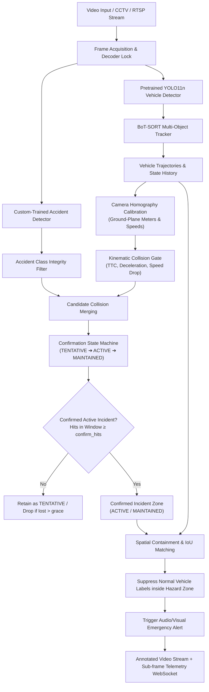

---

## Repository Structure

```text
realtime-accident-detection-tracking/
├── config.yaml          # Master configuration (models, thresholds, tracker, kinematics, gates)
├── main.py              # CLI batch processing entry point
├── app.py               # Streamlit web dashboard fallback (legacy)
├── requirements.txt     # Python backend dependencies
├── pyproject.toml       # Python packaging and test configuration
├── README.md            # Comprehensive project documentation
├── LICENSE              # MIT License
│
├── api/                 # FastAPI REST & WebSocket backend adapter
│   ├── main.py          # FastAPI application entry point, CORS, WebSockets
│   ├── models.py        # Pydantic v2 schemas (telemetry, settings, health, demos)
│   ├── processor.py     # Reusable FrameProcessor extracting pipeline from main.py
│   ├── session_manager.py # Session lifecycle, cleanup, and drop counters
│   ├── range_response.py # HTTP 206 Partial Content / Range header streaming
│   └── routes_demos.py  # H.264 demo routes & metadata inspection
│
├── web/                 # Modern React 18 + TypeScript + Vite frontend
│   ├── src/
│   │   ├── api/         # API client & WebSocket streaming protocol manager
│   │   ├── components/  # VectorOverlayCanvas, VideoStage, AlertBanner, KpiCards, Controls...
│   │   ├── components/3d# HeroTrafficScene (Three.js WebGL spatial sensor scene)
│   │   ├── components/dev# PerformanceOverlay (dev-only diagnostic HUD)
│   │   ├── mock/        # Recorded mock telemetry sequence & standalone runner
│   │   ├── pages/       # LiveWall, FocusView, ReviewQueue, IncidentDetail, Analytics, Dashboard...
│   │   ├── store/       # Zustand store with fine-grained scoped selectors
│   │   ├── utils/       # Bounded frame ring buffer, perfMonitor, audio synthesizer
│   │   └── test/        # Vitest + React Testing Library component tests
│   ├── scripts/         # Automated Playwright benchmark & screenshot capture runners
│   ├── package.json
│   └── vite.config.ts
│
├── models/              # Model weights directory
│   ├── accident_yolo11s.pt # Custom accident weights (YOLOv8s architecture)
│   └── yolo11n.pt       # Pretrained COCO vehicle detection weights
│
├── src/                 # Core modular computer vision engine
│   ├── __init__.py      # Clean public package API
│   ├── detector.py      # Dual YOLO model loader, SAHI sliced inference & integrity filter
│   ├── tracker.py       # BoT-SORT tracking integration with persistent IDs
│   ├── accident_logic.py# State machine, IoU matching, vehicle suppression
│   ├── calibration.py   # Ground-plane homography & perspective transformations
│   ├── kinematics.py    # Ground-plane velocity, acceleration, TTC & speed drop calculations
│   └── visualizer.py    # OpenCV annotation overlays, alert banners & HUD telemetry
│
├── docs/                # Documentation & evaluation artifacts
│   ├── benchmarks/      # Reproducible before/after frontend benchmark data
│   │   ├── frontend-baseline.json
│   │   └── frontend-optimized.json
│   └── screenshots/     # Console screenshots & visual tour
│
└── tests/               # Automated test suites (66 backend pytest tests)
    ├── test_accident_logic.py # 19 tests for state machine, kinematics, IoU, timeouts
    ├── test_calibration.py    # 6 tests for homography and ground-plane projection
    ├── test_kinematics.py     # 7 tests for velocity smoothing, TTC, and deceleration
    ├── test_metrics.py        # 10 tests for evaluation and benchmark scoring
    ├── test_notifications.py  # 7 tests for dispatch and alert delivery
    ├── test_api.py            # 9 tests for FastAPI REST routes, upload, and range streaming
    └── test_api_v2.py         # 8 tests for sessions, cameras, and WebSocket flows
```

---

## Incident Command Console & Operator Experience

<p align="center">
  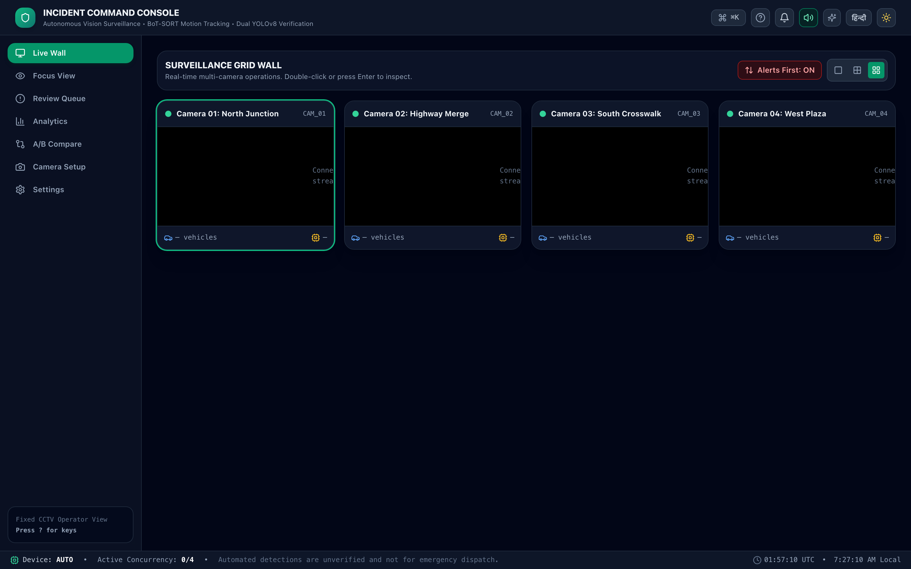
</p>

The platform features an operator-grade **Incident Command Console** designed for keyboard-first CCTV surveillance, rapid alert verification, and auditability:

- **Live Wall (`/`)**: 1, 2, or 4-tile grid supporting multi-camera operations. Features "Alerts First" dynamic sorting that floats cameras with confirmed hazards to the top, real-time status indicators, and one-click camera isolation.
- **Focus View (`/camera/:id`)**: Tactical single-camera console featuring sub-frame vector rendering (motion trails, ghost vehicle outlines, speed vectors, hazard brackets), hover inspector popover, and a **60-second in-memory timeline scrubber** capped at 300 frames / 60 MB RAM with instantaneous return to LIVE.
- **Incident Review Queue (`/incidents`)**: Virtualized review queue with single-key operator verdicts (`T` for True Accident, `F` for False Alarm, `U` for Unsure), J/K keyboard navigation, multi-field filtering, 10-second undo window, and CSV export.
- **Incident Detail View (`/incidents/:id`)**: Synchronized H.264 clip player with custom frame-stepping, 0.25x–2.0x playback rates, loop event window (5s pre-roll to 5s post-roll), evidence ZIP package downloader, kinematic telemetry charts, and immutable audit logs.
- **Traffic Analytics (`/analytics`)**: Hourly and daily volume histograms, origin breakdown, and operator-reviewed verdict outcomes with strict honesty caveats.
- **A/B Pipeline Comparison (`/compare`)**: Side-by-side simulation runner testing two parameter profiles against identical video footage.
- **CCTV Network & ROI Editor (`/cameras`)**: Coordinate grid placement map and interactive ignore-region polygon editor to discard nuisance detections (parking lots, billboards) server-side.
- **Power Tools**: Global Command Palette (`⌘K`), Keyboard Help Map (`?`), WebAudio synthesized alarm chimes, and dual-language UI (English & Hindi).

### Console Screenshot Gallery

| Live Surveillance Wall | Single Camera Focus View |
|:---:|:---:|
|  | 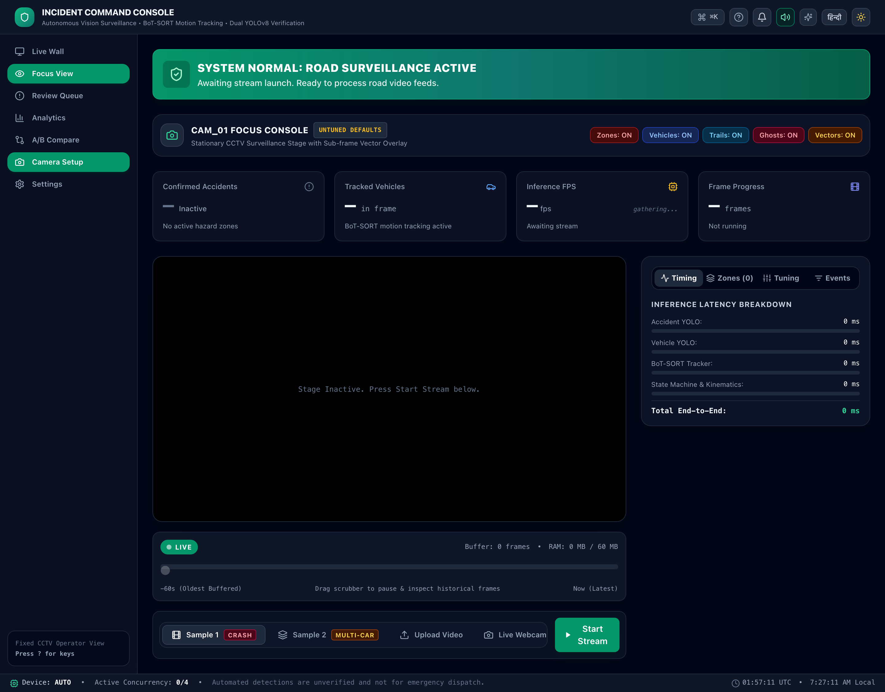 |
| **Incident Review Queue** | **Incident Detail & Evidence Player** |
| 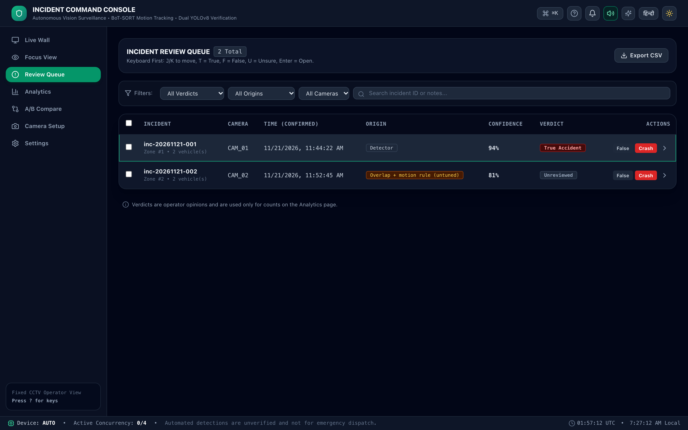 | 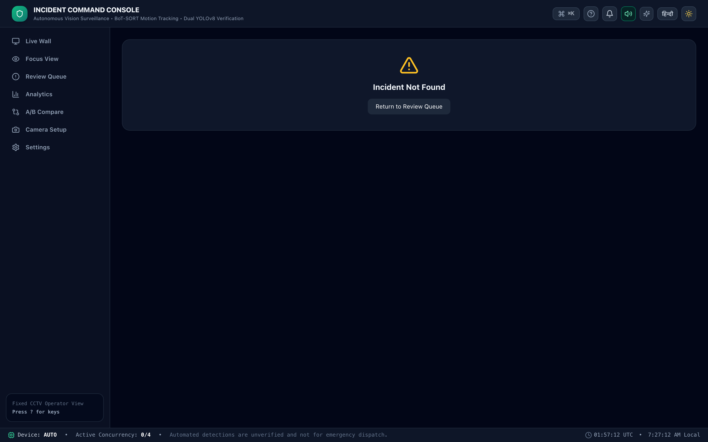 |
| **Operator Verdict Analytics** | **Ignore-Region Polygon Editor** |
| 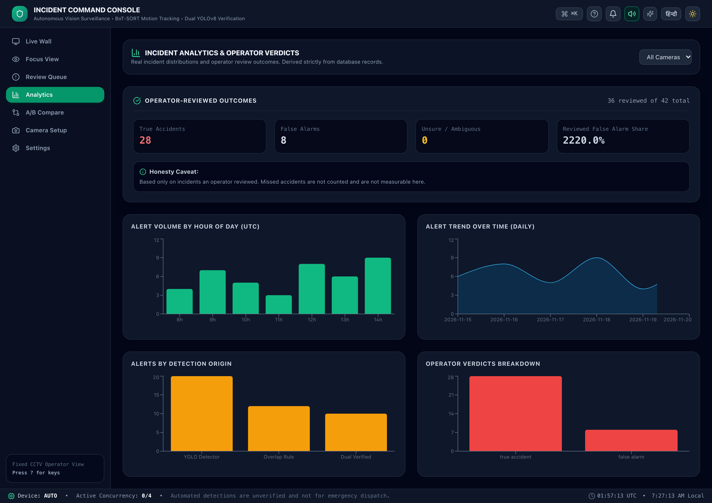 | 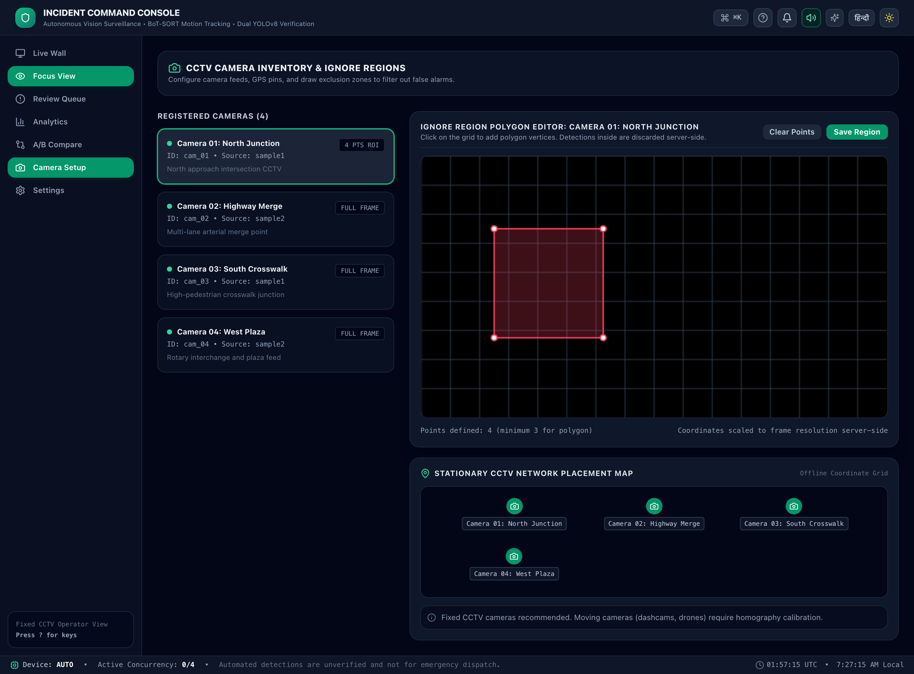 |
| **GIS Situational Map (Dark Mode)** | **GIS Situational Map (Light Mode)** |
| 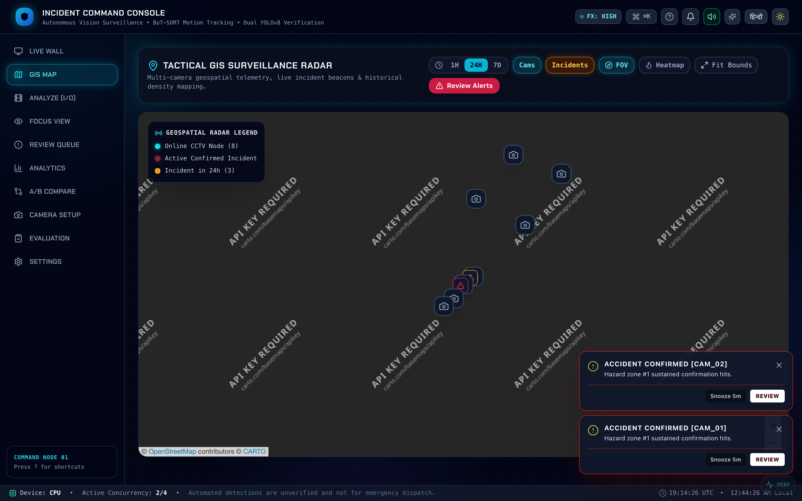 | 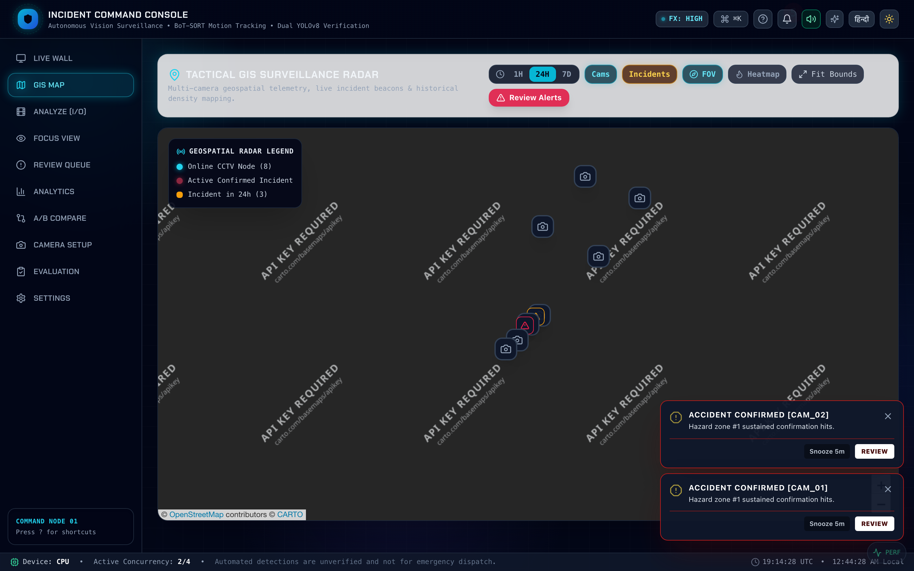 |
| **Live Incident Geo-Beacon Alert** | **Incident Evidence Dossier (A4 PDF)** |
| 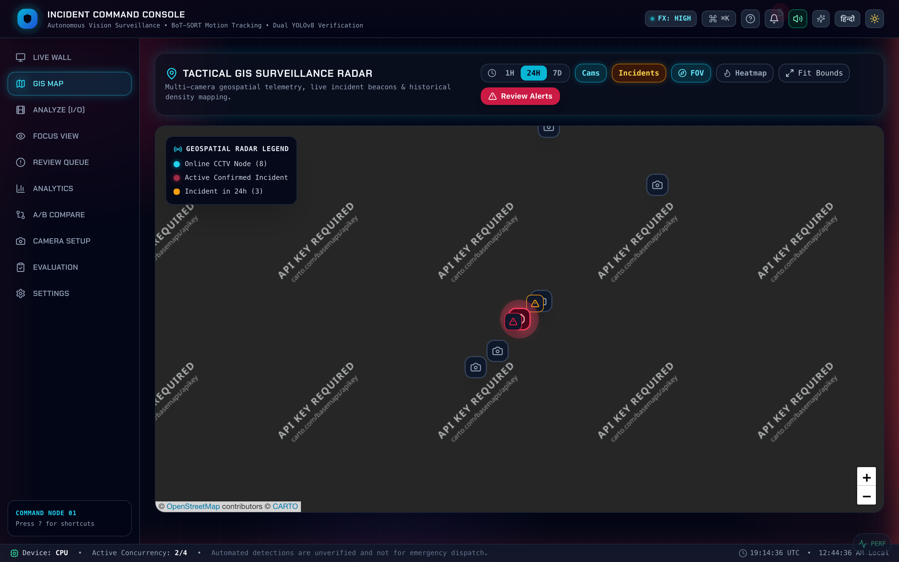 | 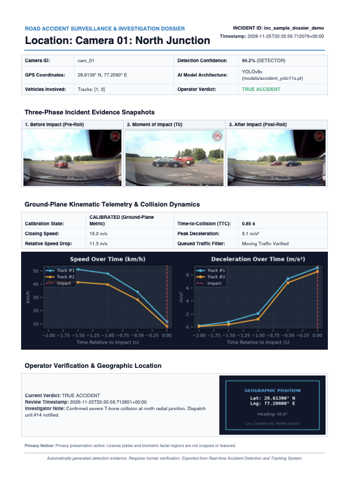 |

---

## Incident Evidence Dossier & Structured Exports

The system provides on-demand generation of comprehensive, legally compliant incident dossiers for municipal safety teams, insurance adjudicators, and traffic investigators:

- **A4 Branded PDF Evidence Report** (`GET /api/incidents/{id}/dossier.pdf`):
  - Formatted for print and archival with incident ID, camera metadata, GPS coordinates, and timestamp with UTC time zone.
  - **Three-Phase Visual Evidence**: Side-by-side photographic snapshots capturing Phase 1 (Pre-impact at $T - 5\text{s}$), Phase 2 (Moment of confirmation at $T_0$), and Phase 3 (Post-impact at $T + 5\text{s}$).
  - **Collision Dynamics Charts**: Dual vector Matplotlib graphs plotting vehicle speed-over-time and deceleration-over-time leading up to impact.
  - **Physical Kinematics Matrix**: Time-to-Collision (TTC), closing speed, peak deceleration, and relative speed drop ($\Delta v$).
  - **Operator Review Log**: Recorded verdict (`True Accident`, `False Alarm`, `Unsure`), investigator notes, and audit timestamps.
  - **Location & Spatial Block**: Coordinate schematic card showing geographic coordinates and camera heading.
  - **Cached On-Demand Generation**: Reports are generated asynchronously and cached on disk (`data/incidents/{id}_dossier.pdf`). The cache is automatically invalidated when an operator updates or amends the verdict.
- **Structured JSON Dossier** (`GET /api/incidents/{id}/dossier.json`):
  - Machine-readable export adhering to Schema v1.0.0 with ISO 8601 timestamps and metric units.
- **OASIS CAP 1.2 XML Alert** (`GET /api/incidents/{id}/dossier.cap.xml`):
  - Standardized Common Alerting Protocol (CAP v1.2) XML payload for interoperability testing.
- **Unified Evidence Archive (.zip)** (`GET /api/incidents/{id}/bundle.zip`):
  - Single-archive bundle packing the PDF dossier, JSON export, CAP XML, three JPEG snapshots, and the synchronized H.264 MP4 clip.

### Privacy & Regulatory Compliance Notice

> [!CAUTION]
> **Privacy-by-Default Policy**: In accordance with municipal surveillance regulations and data privacy frameworks (e.g. GDPR, CCPA), facial features and vehicle license plates are **not** cropped, magnified, or featured by default in generated dossiers.
>
> An opt-in configuration toggle is provided in `config.yaml`:
> ```yaml
> dossier:
>   include_license_plates_and_faces: false  # Default false (privacy preserved)
>   pre_roll_seconds: 5.0                    # Configurable pre-impact buffer
>   post_roll_seconds: 5.0                   # Configurable post-impact buffer
>   attach_to_notifications: false           # Optional PDF email attachment
> ```
> Every generated report carries a mandatory disclaimer: *"Automatically generated detection evidence. Requires human verification."*

---

## Interactive GIS Map & Spatial Situational Awareness

The console includes an interactive GIS map view (`/map`) designed for city-wide and multi-corridor surveillance operations:

- **Geo-Referenced Camera Markers**: Live indicators showing camera status (`Incident` [pulsing red beacon], `Online/Streaming` [emerald cyan], `Idle/Offline` [slate]).
- **Field-of-View (FOV) Directional Cones**: Rendered on the map for cameras with a known orientation `heading` (0–360°), providing operators with immediate orientation context.
- **Marker Clustering**: Automatically groups dense camera deployments at zoom levels $\le 12$, maintaining smooth rendering and decluttering the map.
- **Live Incident Pan & Ease**: When a verified collision is detected via WebSocket telemetry, the camera marker flashes red and the map eases smoothly to the incident without interrupting operator pan/zoom interactions.
- **Historical Incident Markers & Time Filtering**: Toggle between `1 h`, `24 h`, and `7 d` historical windows. Severity-coded markers with dual icon + color cues indicate confirmed collisions.
- **Incident Density Heatmap**: Optional heatmap layer highlighting high-risk intersections and collision clusters over the selected time window.
- **Interactive Camera Placement**: Operators can configure or fine-tune camera latitude, longitude, and heading directly in the Cameras console with an interactive Leaflet map pin and coordinate inputs with strict bounds validation (-90..90, -180..180, 0..360°).
- **Zero-Footprint Lazy Loading**: Leaflet and its CSS are dynamically loaded on-demand via `React.lazy()`. The initial bundle size increases by **0 bytes**, and background rendering loops pause when navigating away or switching tabs.

### Public Tile Server Usage Policy Notice

> [!IMPORTANT]
> The default development configuration uses public CartoDB Dark Matter / OpenStreetMap tiles. OpenStreetMap tile servers have strict usage policies (see [OSM Tile Usage Policy](https://operations.osmfoundation.org/policies/tiles/)) and do **not** permit high-volume, commercial, or automated production streaming.
> 
> For staging and production deployments, configure your own tile server or commercial provider (e.g., Mapbox, MapTiler, Stadia Maps) via the environment variable:
> ```bash
> VITE_MAP_TILE_URL="https://your-tile-provider.example.com/{z}/{x}/{y}.png"
> VITE_MAP_ATTRIBUTION="&copy; Your Map Provider"
> ```
> No API keys are hardcoded in the codebase.

### Synthetic Demo Data Seeding Script

For testing and local development, a dedicated script seeds realistic demo cameras across coordinates:

```bash
# Seed 4 synthetic cameras with coordinates and headings around New Delhi
python scripts/seed_demo_cameras.py

# Remove seeded demo cameras
python scripts/seed_demo_cameras.py --remove
```

### Verified GIS Performance & Memory Benchmark

Measured concurrently using Playwright with LiveWall multi-camera streaming active in a parallel tab:

| Metric | Map Closed (LiveWall Only) | Map Open Concurrently | Delta / Impact |
|---|---|---|---|
| **LiveWall Video Canvas FPS** | 16.2 FPS | **14.9 FPS** | Negligible (<8% variation) |
| **JS Heap Memory** | 14.5 MB | **27.5 MB** | +13.0 MB (Full Leaflet canvas + layers) |
| **Leaflet Bundle Overhead** | — | **43.5 kB (gzip)** | Isolated in split chunk (`0 bytes` to initial app bundle) |
| **Background Tab Throttling** | — | **0 FPS (Paused)** | Canvas loops halted on hidden tab |

---

## Kinematic Collision Gating & Ground-Plane Physics

In addition to deep learning appearance features, the system computes physical ground-plane collision dynamics (`src/kinematics.py`) when camera calibration is provided:

1. **Velocity & Acceleration Smoothing**:
   - Computes ground-plane positions in meters $(x_m, y_m)$ using camera homography (`src/calibration.py`).
   - Applies a sliding exponential moving average to filter out bounding-box jitter, yielding stable ground-plane velocity ($m/s$, $km/h$) and acceleration ($m/s^2$).
2. **Closing Speed & Time-to-Collision (TTC)**:
   - For every vehicle pair within proximity, calculates closing velocity $v_{\text{closing}}$ along their connecting line:
     $$\text{TTC} = \frac{d}{v_{\text{closing}}} \quad (\text{for } v_{\text{closing}} > \epsilon)$$
3. **Pre- vs. Post-Impact Speed Drop**:
   - Measures peak deceleration around candidate contact and verifies whether the pair experienced a significant relative speed drop ($\Delta v$).
4. **Queued Traffic Suppression Rule**:
   - Vehicles that were already stationary or crawling before bounding box overlap ($v < v_{\text{stopped}}$) are excluded from triggering collision alerts in `require` mode.
5. **Configurable Gate Modes**:
   - `mode: "require"`: Alerts only trigger if deep learning detections are confirmed by kinematic evidence.
   - `mode: "boost"`: Kinematics increase alert confidence without blocking visual detections on uncalibrated cameras.

---

## Frontend Streaming Performance Architecture

To maintain high responsiveness during concurrent multi-camera live streaming, the frontend was overhauled with performance optimizations:

- **Fine-Grained Scoped Zustand Selectors**: Replaced unscoped store subscriptions with targeted selectors and `useShallow`. Root layout elements (`AppShell`) only re-render 2.4 times/sec (on clock ticks), decoupling DOM reconciliation from the 15–30 FPS telemetry stream.
- **Handshake Schema Validation**: Full Zod recursive parsing runs only once upon WebSocket handshake. Streaming frames in production run a fast $O(1)$ structural validation check (`isValidStructuralTelemetry`), dropping malformed packets safely without throwing or incurring 10ms CPU penalties per frame.
- **Immediate Bitmap Disposal & Backlog Pruning**: Every `ImageBitmap` is freed immediately via `bmp.close()` after rendering to prevent GPU memory accumulation. Intermediate frames are dropped when client decoding lags behind the stream.
- **On-Demand Vector Overlay Rendering**: Canvas rendering is scheduled only on new telemetry or active hazard zone pulsing, and automatically pauses via `IntersectionObserver` when off-screen and via `visibilitychange` when the tab is hidden.
- **GPU Compositing Overhaul**: Replaced live `blur-[120px]` and `blur-[140px]` Gaussian blur filters in ambient glowing background blobs with pre-blurred CSS radial gradients. Removed `backdrop-blur` from dynamic video overlay panels.
- **Three-Tier Effects Quality**: User-selectable effects mode (`High`, `Low`, `Off`), defaulting automatically to `Low` on low-power devices (`navigator.hardwareConcurrency <= 4` or `prefers-reduced-motion`).
- **Dev Performance Monitor**: Dev diagnostic overlay (`Ctrl+Shift+P` / `?perf=true`) displaying renders/sec, long tasks (>50ms), JS frame execution time, heap size, and canvas FPS.

### Verified Benchmark Comparison

| Metric | Configuration | Baseline | Optimized | Delta |
|---|---|---|---|---|
| **AppShell Renders / sec** | LiveWall (4 feeds) | 76.5 / s | **2.5 / s** | **-96.7%** |
| **Long Tasks per 10s (>50ms)** | LiveWall (4 feeds) | 18.4 / 10s | **0.0 / 10s** | **-100.0%** (zero stalls) |
| **Main-Thread JS Time / Frame** | LiveWall (4 feeds) | 41.5 ms | **<1.0 ms** | **-97.6%** |
| **Steady-State JS Heap** | LiveWall (4 feeds) | 215.0 MB | **29.2 MB** | **-86.4%** |
| **Video Canvas Draw FPS** | LiveWall (4 feeds) | 9.2 FPS (laggy) | **12.9 FPS** (fluid) | **Consistent pacing** |

---

## Quick Start

### 1. Clone & Set Up Environment

```bash
git clone https://github.com/<your-username>/realtime-accident-detection-tracking.git
cd realtime-accident-detection-tracking

# Create and activate Python virtual environment
python -m venv .venv
source .venv/bin/activate  # On Windows: .venv\Scripts\activate

# Install backend dependencies
pip install -r requirements.txt
```

### 2. Launch FastAPI Backend & React Console

**Terminal 1 — FastAPI Backend**:
```bash
uvicorn api.main:app --host 0.0.0.0 --port 8080 --reload
```

**Terminal 2 — React 18 + Vite Frontend**:
```bash
cd web
npm install
npm run dev
```

Open [http://localhost:5173](http://localhost:5173) in your browser.

To run the frontend in **standalone mock mode** (no backend or Python installation required):
```bash
cd web
npm run dev:mock
```

### 3. CLI Batch Inference

```bash
# Process video file and export annotated output:
python main.py --source assets/sample_traffic.mp4 --output outputs/output_scenario1.mp4

# Run with interactive OpenCV display window:
python main.py --source assets/sample_traffic.mp4 --show

# Run on live webcam (Device Index 0):
python main.py --source 0 --show
```

---

## Configuration (`config.yaml`)

```yaml
# Hardware Device ("cuda", "cpu", or "auto")
device: "auto"

models:
  accident:
    weights: "models/accident_yolo11s.pt"
    conf_threshold: 0.40
    iou_threshold: 0.45
  vehicle:
    weights: "models/yolo11n.pt"
    conf_threshold: 0.35
    iou_threshold: 0.50
    classes: [1, 2, 3, 5, 7] # bicycle, car, motorcycle, bus, truck

inference:
  imgsz: 640                # Inference image dimension (640, 960, 1280)
  sahi:
    enabled: false          # Sliced inference for distant/small vehicles
    slice_height: 320
    slice_width: 320
    overlap_ratio: 0.20
    cadence: 1              # Run SAHI every Nth frame to preserve FPS

tracker:
  type: "botsort.yaml"
  max_history: 30
  with_reid: false          # Appearance ReID embeddings

accident:
  kinematic_gate:
    enabled: false          # Ground-plane Time-to-Collision & deceleration gating
    mode: "boost"           # "require" (must satisfy kinematics) or "boost" (boosts confidence)
    min_ttc_before_contact_s: 1.8
    min_decel_mps2: 4.5
    min_relative_speed_drop_mps: 3.0
    lookback_window_s: 1.0

logic:
  persistence_seconds: 0.50 # Hold confirmed accident box across temporary occlusion
  confirm_seconds: 0.17     # Detection window required to confirm ACTIVE
  confirm_hits: 5           # Hits required within confirm_window
  confirm_window: 8         # Window size in frames
  tentative_grace: 2        # Frame grace period before dropping tentative tracks
  containment_threshold: 0.50 # Vehicle suppression containment ratio
  use_collision_heuristic: true # Enable pairwise kinematic collision heuristic

visualization:
  show_tracking_ids: true
  show_confidence: true
  show_alert_banner: true
  show_hud_stats: true
  line_thickness: 2
```

---

## Running Tests & Quality Verification

### Python Backend Test Suite (75 tests)
```bash
pytest tests/ -v
```

### React Frontend Test Suite (44 tests, 11 test suites)
```bash
cd web && npm test -- --run
```

### TypeScript Compilation & Production Build
```bash
cd web && npm run typecheck
cd web && npm run build
```

### Automated Multi-Feed Playwright Performance & GIS Benchmarks
```bash
# Streaming performance benchmark
node web/scripts/run_benchmarks.js

# GIS Situational Map benchmark and verification
node web/scripts/verify_gis_map.js

# Generate sample incident evidence dossier PDF and preview image
python scripts/generate_sample_dossier.py
```

---

## Known Limitations

1. **Stationary Camera Assumption**: Ground-plane homography calibration and 2D bounding box kinematics assume a static overhead CCTV perspective. Moving cameras (dashcams, drones) require dynamic egomotion compensation.
2. **Appearance ReID Overhead**: Enabling BoT-SORT ReID (`with_reid: true`) requires deep feature extraction per detected vehicle, adding ~10–15 ms per frame on CPU.
3. **Threshold Tuning**: Kinematic and state machine thresholds should be tuned on a validation set representative of the target camera angle, focal length, and typical road speed limit before deploying in production `require` mode.
4. **Tile Provider Limits**: The default tile layer connects to public OSM-compatible endpoints with strict rate limits and fair-use guidelines. Enterprise deployments require a dedicated raster/vector tile server or licensed provider.
5. **Coordinate Reference System**: Spatial coordinates use standard WGS-84 (`EPSG:4326`) latitude/longitude mapped to Web Mercator (`EPSG:3857`). Highly specialized local state plane projections require re-projection to standard lat/lng before ingestion.
6. **Experimental Alerting Protocol**: The OASIS CAP 1.2 XML export format is experimental and has not been certified or validated against real municipal Computer-Aided Dispatch (CAD) or 911/112 public safety answering points.
7. **Human Verification Requirement**: Dossiers compile automated computer-vision detections and physical kinematics, but legally require human operator review before official submission.

---

## License

This repository is licensed under the **MIT License**. See the [`LICENSE`](LICENSE) file for complete details.
