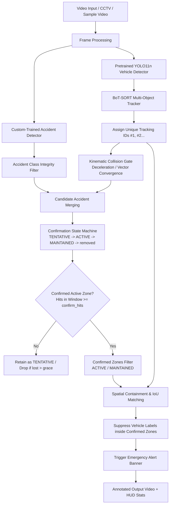

# Accident Detection & Vehicle Tracking System

<div align="center"> 
   
</div>

<br>

[](https://www.python.org/)
[](https://github.com/ultralytics/ultralytics)
[](https://opencv.org/)
[](https://github.com/NirAharon/BoT-SORT)
[](LICENSE)

An intelligent, real-time traffic monitoring and incident surveillance system developed using **Ultralytics YOLO**, **BoT-SORT tracking**, **Python**, and **OpenCV**. The system orchestrates dual deep learning inference, multi-object trajectory tracking, a multi-frame confirmation state machine, and kinematic collision gating to detect road accidents and track vehicular traffic.

<p align="center">
  <b>Scenario 1: Vehicle Collision Dynamics & Alert Trigger</b><br/>
  
</p>

<p align="center">
  <b>Scenario 2: Multi-Vehicle Incident & Traffic Collision Surveillance</b><br/>
  
</p>

---

## System Architecture & Workflow



---

## Repository Structure

```text
road-accident-detection/
├── config.yaml          # Master configuration file (models, thresholds, tracker, state machine)
├── main.py              # CLI entry point to run inference on videos or webcam
├── app.py               # Streamlit web dashboard on localhost
├── requirements.txt     # Python dependencies
├── README.md            # Comprehensive project documentation
├── LICENSE              # MIT License
├── .gitignore           # Ignored temporary files & model checkpoints
│
├── models/              # Model weights directory
│   ├── accident_yolo11s.pt # Custom accident weights (YOLOv8s architecture, see Model Details)
│   └── yolo11n.pt       # Pretrained COCO vehicle detection weights
│
├── assets/              # Sample media assets for testing
│   ├── demo_1.gif       # Scenario 1 demonstration animation
│   ├── demo_2.gif       # Scenario 2 demonstration animation
│   ├── sample_traffic.mp4   # Sample traffic video (Scenario 1, 720p HD @ 30 FPS)
│   └── sample_traffic_2.mp4 # Multi-car incident video (Scenario 2, 720p HD @ 30 FPS)
│
├── outputs/             # Output directory for generated annotated videos
│   └── .gitkeep
│
├── src/                 # Core modular source code
│   ├── __init__.py      # Clean public package API
│   ├── detector.py      # Dual YOLO model loader & class integrity filter
│   ├── tracker.py       # BoT-SORT tracking integration with persistent IDs
│   ├── accident_logic.py# State machine, kinematic collision gating, IoU, suppression
│   └── visualizer.py    # OpenCV annotation overlays, alert banners & HUD dashboard
│
└── tests/               # Unit test suite
    ├── __init__.py
    └── test_accident_logic.py # 19 unit tests for state machine, kinematics, IoU, timeouts
```

---

## Model Details & Architecture Notes

- **Accident Detector (`models/accident_yolo11s.pt`)**:
  - *Checkpoint Architecture*: Checkpoint metadata confirms this model uses the **YOLOv8s** architecture (`yolov8s.yaml`, 129 layers, 11,135,987 parameters, trained April 2023 for 25 epochs), despite the file name `accident_yolo11s.pt`. It is recommended to rename this checkpoint to `accident_yolov8s.pt` or fine-tune a genuine YOLO11s model in future training runs (the existing filename is preserved for backward compatibility).
  - *Target Class*: Single class `{0: 'Accident'}`.
- **Vehicle Detector (`models/yolo11n.pt`)**:
  - *Architecture*: Ultralytics YOLO11n (Nano, 2.6M parameters).
  - *Classes*: Filtered to 5 COCO road transport classes: `1: bicycle`, `2: car`, `3: motorcycle`, `5: bus`, `7: truck`.
- **Model Class Integrity Filter (formerly "Zero False-Positive Guard")**:
  - Inspects the loaded model's class dictionary at initialization. If a standard generic COCO model (lacking accident/crash classes) is supplied in place of the accident model, accident reporting is safely disabled.
  - *Clarification*: This filter prevents a generic vehicle model from misclassifying ordinary traffic as accidents; it does **not** eliminate false positives originating from the custom accident model itself.

---

## Confirmation State Machine & Kinematic Gating

To mitigate false alarms in dense traffic and transient visual artifacts, the pipeline implements:

1. **Multi-Frame State Machine (`TENTATIVE -> ACTIVE -> MAINTAINED -> removed`)**:
   - New candidate detections enter as `TENTATIVE`.
   - A zone promotes to `ACTIVE` only after achieving $\ge \text{confirm\_hits}$ detections within a sliding window of $\text{confirm\_window}$ frames (default: 5 hits in 8 frames, $\approx 0.17$s at 30 FPS).
   - If an unconfirmed `TENTATIVE` zone is lost for more than `tentative_grace` frames (default: 2 frames), it is dropped immediately.
   - An `ACTIVE` zone that loses detection transitions to `MAINTAINED` for up to `persistence_frames` (default: 15 frames / 0.50s at 30 FPS) before removal, absorbing temporary occlusion.
   - **Emergency alerts, HUD counts, visual suppression, and visualizer rendering operate exclusively on confirmed zones (`ACTIVE` or `MAINTAINED`).**
2. **Kinematic Collision Gating**:
   - Rather than alerting on 2D bounding box overlap alone, `detect_vehicle_collisions()` requires:
     - Multi-frame consecutive overlap ($\ge 3$ frames).
     - Kinematic cue: sharp deceleration ($\Delta v \ge 120$ px/s) OR converging velocity vectors with significant relative speed ($\ge 80$ px/s).
     - Explicit exclusion of parallel vehicles moving in the same heading with similar speeds (filtering out normal queues and lane merges).
     - Collision zones match existing zones by vehicle ID pair (`(id1, id2)`), preventing ID flapping during vehicle rotation.
     - Can be toggled with `use_collision_heuristic: false`.
3. **Time-Based Timeouts**:
   - Configurable in seconds (`persistence_seconds`, `confirm_seconds`, `tentative_grace_seconds`) and converted dynamically via `max(1, round(fps * seconds))`.
   - Invalid or zero FPS falls back safely to 30.0 FPS with a warning.

---

## Quick Start

### 1. Clone & Set Up Environment

```bash
git clone https://github.com/<your-username>/road-accident-detection.git
cd road-accident-detection

# Create and activate virtual environment
python -m venv .venv
source .venv/bin/activate  # On Windows: .venv\Scripts\activate

# Install dependencies
pip install -r requirements.txt
```

### 2. Run Inference via CLI

```bash
# Scenario 1 (Collision Dynamics, ~11.9s):
python main.py --source assets/sample_traffic.mp4 --output outputs/output_scenario1.mp4

# Scenario 2 (Multi-Car Incident, ~17.3s):
python main.py --source assets/sample_traffic_2.mp4 --output outputs/output_scenario2.mp4

# Run with Live Preview Window:
python main.py --source assets/sample_traffic.mp4 --show

# Run on Live Webcam (Camera index 0):
python main.py --source 0 --show

# Disable collision heuristic (evaluate neural model only):
python main.py --source assets/sample_traffic.mp4 --no-collision-heuristic
```

### 3. Run Web Dashboard (localhost)

```bash
streamlit run app.py --server.port 8502
```
Access at `http://localhost:8502` to upload custom videos, tune confirmation thresholds, or watch pre-rendered results.

---

## Configuration (`config.yaml`)

```yaml
# Hardware Device ("cuda", "cpu", or "auto")
device: "auto"

models:
  accident:
    weights: "models/accident_yolo11s.pt"
    conf_threshold: 0.40
    iou_threshold: 0.45
  vehicle:
    weights: "models/yolo11n.pt"
    conf_threshold: 0.35
    iou_threshold: 0.50
    classes: [1, 2, 3, 5, 7]

tracker:
  type: "botsort.yaml"
  max_history: 30

logic:
  persistence_seconds: 0.50       # Time to hold confirmed accident box across temporary loss
  confirm_seconds: 0.17           # Detection window required to confirm ACTIVE
  tentative_grace_seconds: 0.07   # Grace time before dropping unconfirmed tentative zone
  confirm_hits: 5                 # Fallback hit count to confirm zone
  confirm_window: 8               # Evaluation window size in frames
  tentative_grace: 2              # Frame grace period for tentative drops
  persistence_frames: 15          # Fallback frame count for persistence
  containment_threshold: 0.50     # Vehicle suppression containment ratio
  iou_match_threshold: 0.30       # IoU threshold for matching accident detections
  smoothing_alpha: 0.70           # EMA bounding box smoothing factor
  suppress_vehicle_labels: true   # Suppress normal vehicle labels inside confirmed accident zones
  use_collision_heuristic: true   # Enable kinematic vehicle-vehicle collision heuristic

visualization:
  show_tracking_ids: true
  show_confidence: true
  show_alert_banner: true
  show_hud_stats: true
  line_thickness: 2
```

---

## Performance Benchmarks

| Metric | Measured: Apple Silicon Mac (CPU) | Metal (MPS) | NVIDIA CUDA |
|---|---|---|---|
| **End-to-End Speed** | **11.6 – 14.2 FPS** | *Not benchmarked* | *Not benchmarked* |
| **Pipeline Latency** | ~70 – 85 ms / frame | *Not benchmarked* | *Not benchmarked* |
| **Resolution Tested** | 1280 × 720 HD | — | — |
| **Environment** | Python 3.14, macOS ARM64 | — | — |

*Benchmark Note*: Measured speed represents full end-to-end processing per frame: video decoding (`cv2.VideoCapture`), YOLO11n vehicle inference, BoT-SORT tracking, custom accident YOLO inference, kinematic collision gating, state machine persistence, OpenCV HUD rendering, and video encoding (`cv2.VideoWriter mp4v`).

---

## Known Limitations

1. **No Published Accuracy Metrics**: The bundled accident model does not include held-out test benchmarks (mAP@50, precision/recall curves) or false-alarm-per-hour validation against continuous traffic footage.
2. **Untuned Thresholds**: Kinematic thresholds (deceleration, parallel cosine angle, containment) and state machine windows are sensible engineering heuristics but have not been globally optimized across diverse CCTV perspectives.
3. **Fixed Camera Assumption**: Designed and tested strictly for overhead, stationary surveillance CCTV cameras. Bounding box kinematics assume a static perspective; moving cameras (dashcams, drones) require homography or 3D world-coordinate projection.
4. **ReID Disabled**: BoT-SORT operates with appearance ReID disabled (`with_reid: False`), relying solely on Kalman filtering and IoU association. Severe prolonged occlusions may cause vehicle track ID switches.
5. **Video Codec Compatibility**: Default `mp4v` video output may not stream natively in some web browsers without transcoding to H.264/AVC.
6. **Webcam Device Binding**: The Streamlit webcam option accesses camera device indices on the machine hosting the server process, not the client's browser webcam.

---

## Running Tests

Automated unit tests covering IoU, containment, state machine transitions, kinematic gating, timeouts, and suppression:

```bash
pytest tests/ -v
```

---

## 📄 License

This repository is licensed under the **MIT License**. See the [`LICENSE`](LICENSE) file for complete details.
